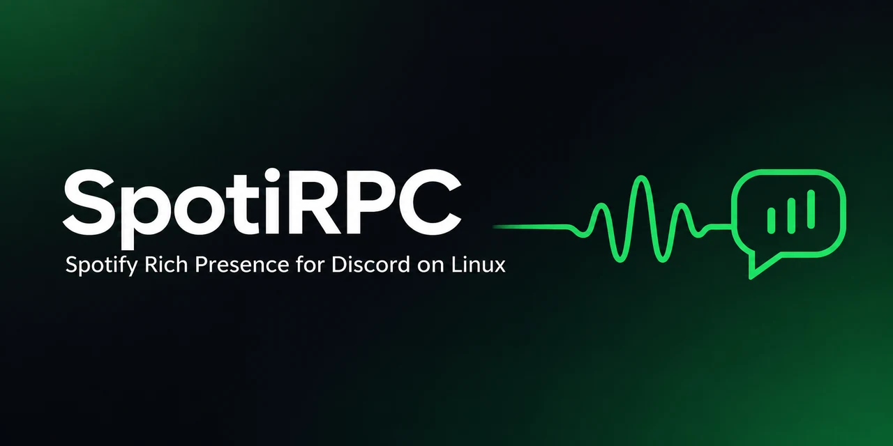

Share what you’re listening to on Discord without linking your Spotify account.

##  What it shows

SpotiRPC shows the track, artist credits, album artwork, and playback progress. Friends can open the track with **Play on Spotify**. Replays get a small session counter, and paused playback shows a simple **Idle** card.

> **Linux only.** Tested on Linux with the Spotify and Discord desktop apps. Other Linux setups may have bugs, and Windows and macOS are unsupported.

## Setup

You’ll need Python 3.9 or newer, `busctl`, and the Spotify and Discord desktop apps.

1. Create an application in the [Discord Developer Portal](https://discord.com/developers/applications). Name it **Spotify** if you want Discord to say **Listening to Spotify**.
2. Create a `.env` file beside `spotirpc.py` and paste the Application ID from **General Information**:

   ```dotenv
   DISCORD_APPLICATION_ID=your_application_id
   ```

3. Open both desktop apps, enable **Activity Sharing** in Discord, and run:

   ```sh
   python3 spotirpc.py
   ```

Press Ctrl+C to stop sharing. Discord shows the **Play on Spotify** button to other viewers of your profile.

SpotiRPC reads local playback over D-Bus and uses Spotify’s public track pages to fill in artist credits when needed. If you use Spotify’s Private Session and want to keep that playback off Discord, stop SpotiRPC or turn off Discord Activity Sharing.
